<div align="center">

<a href="https://spotifreeweb.vercel.app">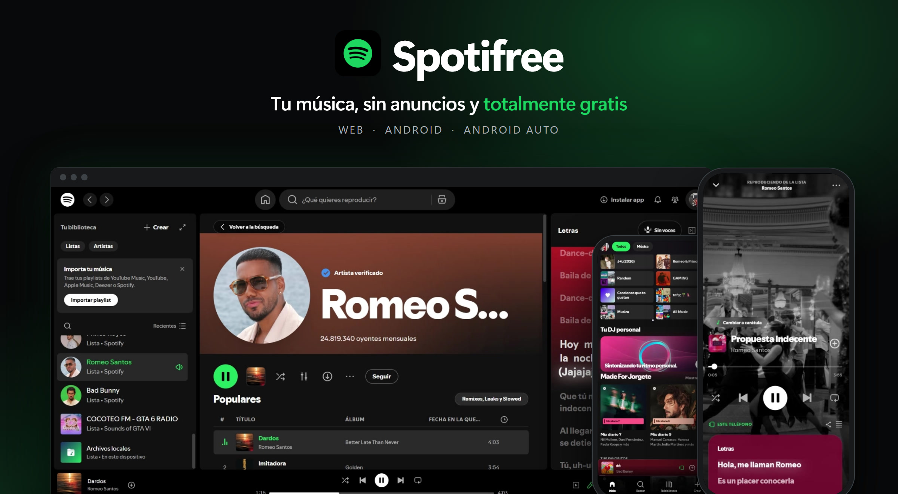</a>

<br />
<br />

**Reproductor de música gratuito con la experiencia de Spotify en el navegador, Android y Android Auto.**<br />
Modo DJ, karaoke, escucha sin conexión y sesiones compartidas.

<br />

[](https://spotifreeweb.vercel.app)
[](https://github.com/Gekamil/spotifree/releases/download/android-latest/Spotifree.apk)

[](./src/data/changelog.ts)
[](https://github.com/Gekamil/spotifree/actions/workflows/android-apk.yml)
[](https://github.com/Gekamil/spotifree/commits/main)
[](https://github.com/Gekamil/spotifree/stargazers)

<br />

[**Demo**](#demo) &nbsp;·&nbsp; [**Características**](#características) &nbsp;·&nbsp; [**Capturas**](#capturas) &nbsp;·&nbsp; [**Arquitectura**](#arquitectura) &nbsp;·&nbsp; [**Instalación**](#instalación)

</div>

<br />

## Demo

<div align="center">

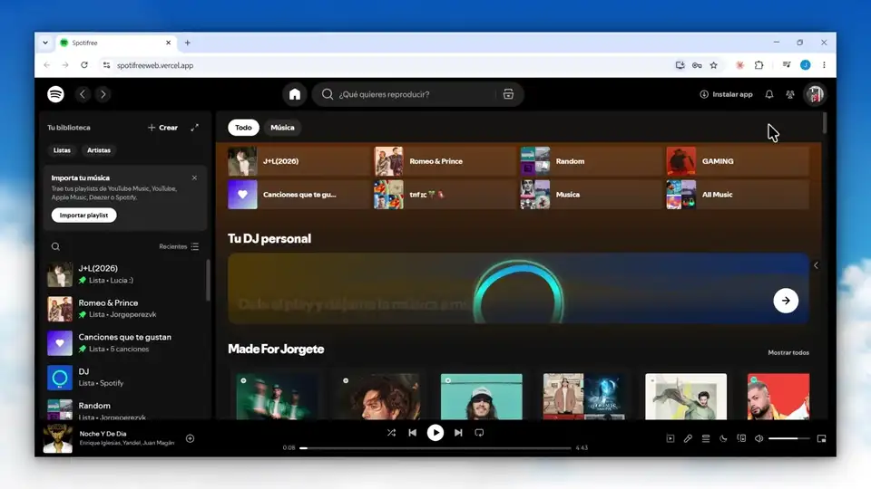

<sub><b>Ordenador</b> &nbsp;·&nbsp; <a href="./docs/media/ordenador.mp4">Ver en MP4</a></sub>

<br />
<br />

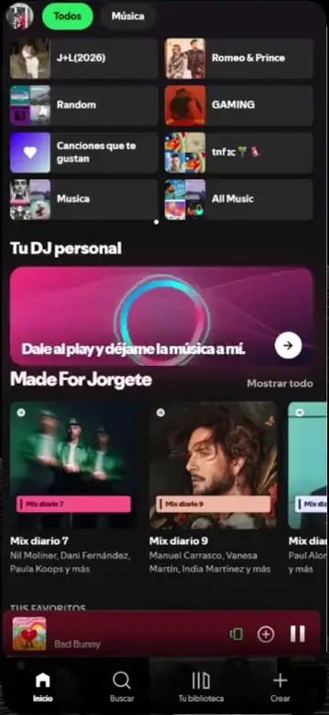

<sub><b>Móvil</b> &nbsp;·&nbsp; <a href="./docs/media/movil.mp4">Ver en MP4</a></sub>

</div>

<br />

## Características

<table>
<tr>
<td width="50%" valign="top">
<h3>Catálogo unificado</h3>
Una sola búsqueda en Spotify, Deezer, iTunes, SoundCloud y YouTube. Álbumes, perfiles de artista con discografía completa, carátulas HD y portadas animadas. Los remixes oficiales tienen prioridad.
</td>
<td width="50%" valign="top">
<h3>Modo DJ</h3>
Mezcla armónica con rueda Camelot y emparejamiento de BPM, incluido doble y mitad de tempo. Siete estilos de transición, orbe animado y control por texto o voz.
</td>
</tr>
<tr>
<td width="50%" valign="top">
<h3>Letras y karaoke</h3>
Letra sincronizada línea a línea en ordenador y móvil, con modo sin voces y control del volumen de la voz.
</td>
<td width="50%" valign="top">
<h3>Offline y biblioteca</h3>
Descarga de canciones y listas, archivos locales, playlists colaborativas en tiempo real, historial de versiones y sincronización con Firebase.
</td>
</tr>
<tr>
<td width="50%" valign="top">
<h3>Audio y sesiones</h3>
Ecualizador, selector de salida (altavoz, auriculares, Bluetooth o USB), sesiones para escuchar juntos con PeerJS y estadísticas de escucha.
</td>
<td width="50%" valign="top">
<h3>Android Auto y widgets</h3>
Pestañas de Inicio, Recientes, Tu biblioteca y Explorar en el coche, con letra y comandos de voz. Dos widgets, incluido un tocadiscos animado.
</td>
</tr>
</table>

<br />

## Capturas

### Ordenador

<table>
<tr>
<td width="50%">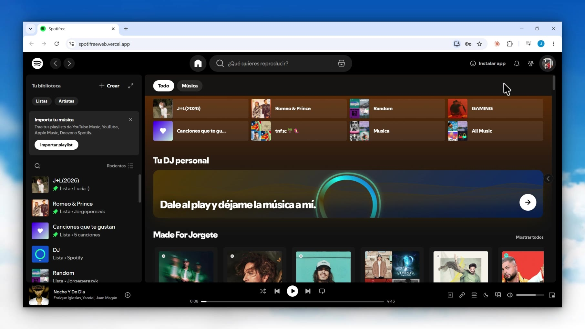</td>
<td width="50%">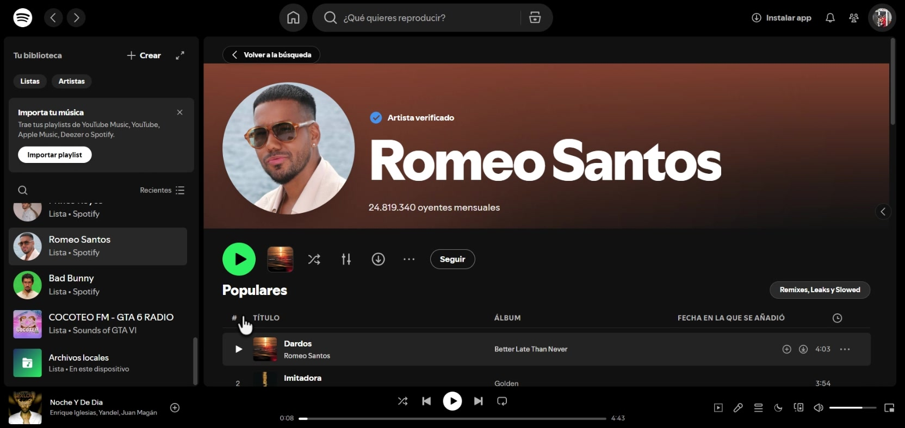</td>
</tr>
<tr>
<td align="center"><sub>Inicio</sub></td>
<td align="center"><sub>Perfil de artista</sub></td>
</tr>
<tr>
<td width="50%">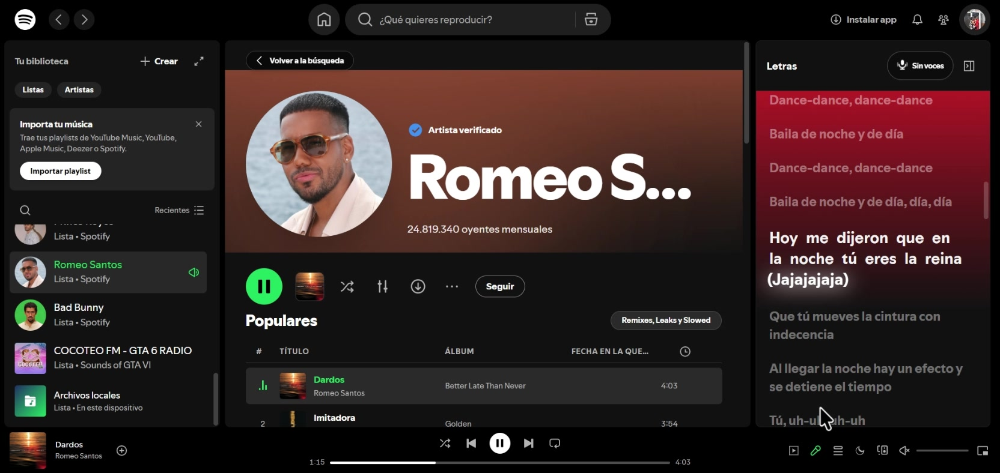</td>
<td width="50%">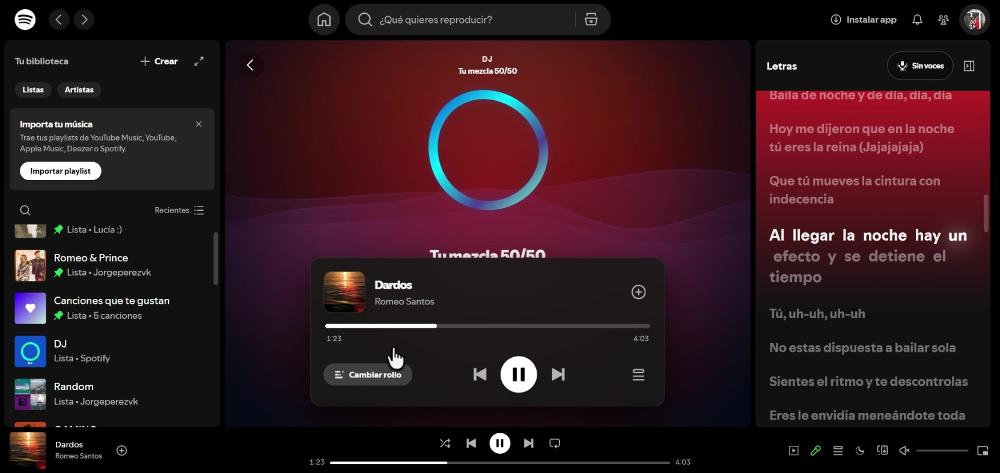</td>
</tr>
<tr>
<td align="center"><sub>Letra sincronizada</sub></td>
<td align="center"><sub>Modo DJ</sub></td>
</tr>
</table>

### Móvil

<table>
<tr>
<td width="20%">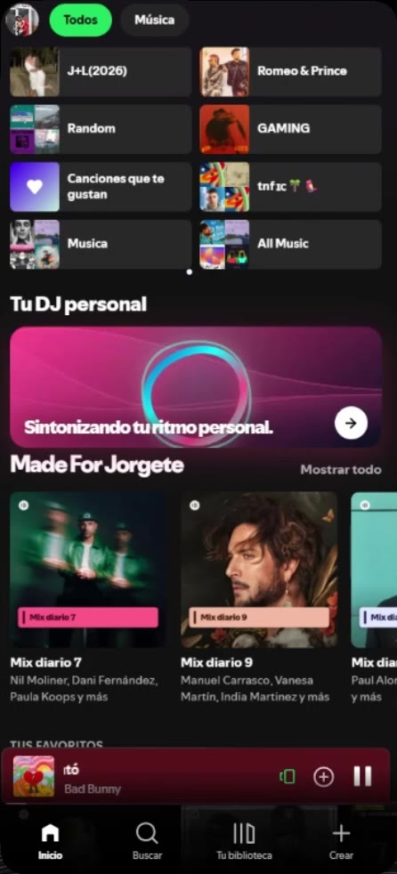</td>
<td width="20%"></td>
<td width="20%">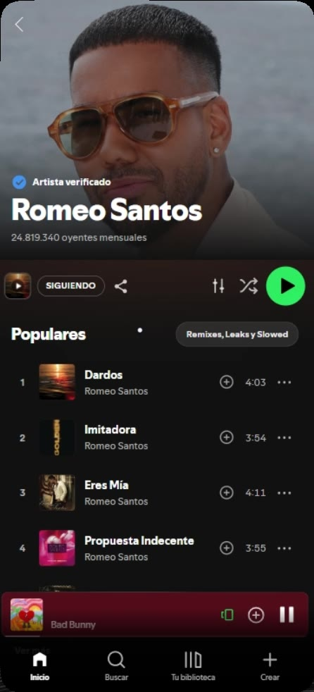</td>
<td width="20%">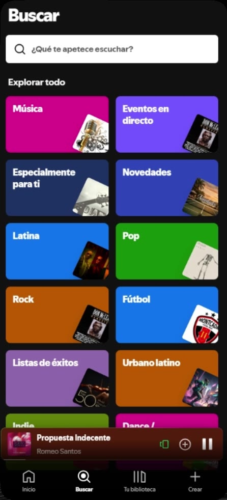</td>
<td width="20%">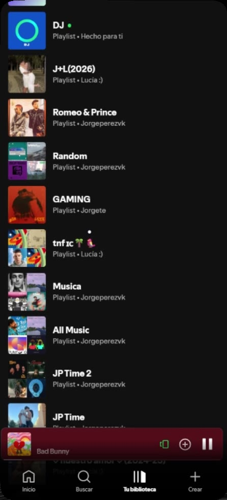</td>
</tr>
<tr>
<td align="center"><sub>Inicio</sub></td>
<td align="center"><sub>Reproductor</sub></td>
<td align="center"><sub>Artista</sub></td>
<td align="center"><sub>Buscar</sub></td>
<td align="center"><sub>Biblioteca</sub></td>
</tr>
</table>

Spotifree detecta el dispositivo y carga una interfaz propia para cada uno:

| | Ordenador | Móvil |
| :--- | :--- | :--- |
| **Navegación** | Biblioteca en barra lateral, buscador superior y panel «Sonando ahora» | Barra inferior: Inicio, Buscar, Tu biblioteca y Crear |
| **Reproductor** | Barra inferior fija con letra, cola y minirreproductor | Mini-reproductor que se amplía a pantalla completa |
| **Instalación** | Se usa desde el navegador | Navegador, web instalable o APK para Android |

<br />

## Arquitectura

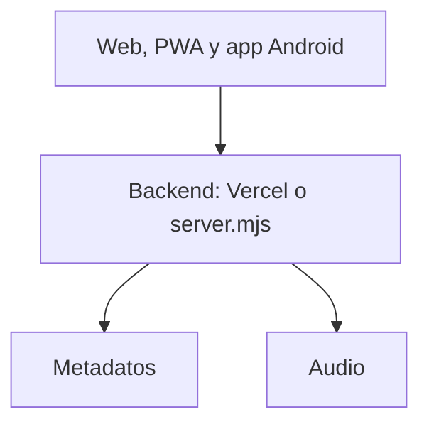

Los metadatos y el audio llegan a través del backend. La sincronización usa Firebase y las sesiones compartidas, PeerJS.

| Capa | Tecnologías |
| :--- | :--- |
| **Frontend** | React 19, TypeScript, Vite 8, Tailwind CSS, Zustand |
| **Audio y DSP** | Web Audio API (cadena de 10 nodos, ecualizador, barridos resonantes, delay sincronizado), `hls.js`, Web Workers |
| **Backend** | Funciones serverless en Vercel y servidor Node (`server.mjs`) con `yt-dlp`, `youtubei.js`, `play-dl` y SoundCloud como respaldo |
| **Android** | Capacitor 8, plugins nativos en Java, `MediaBrowserService` para Android Auto, widgets `AppWidgetProvider` |
| **Datos y tiempo real** | Firebase, PeerJS |

<br />

## Instalación

**Requisitos:** Node.js 20 o superior. Para el audio completo en el backend local, además Python 3, `ffmpeg` y `yt-dlp`.

```bash
git clone https://github.com/Gekamil/spotifree.git
cd spotifree
npm install
npm run dev
```

Para levantar también el backend de audio, que escucha en `http://localhost:10000` (configurable con `PORT`):

```bash
node server.mjs
```

<details>
<summary><b>Docker</b></summary>
<br />

El `Dockerfile` instala Node 20, Python 3, `ffmpeg` y `yt-dlp`, compila el frontend y arranca `server.mjs` en el puerto `10000`.

```bash
docker build -t spotifree .
docker run -p 10000:10000 spotifree
```

</details>

<details>
<summary><b>Compilar el APK de Android</b></summary>
<br />

La app carga la web desplegada, con `offline.html` como respaldo, y añade los plugins nativos. En local requiere Android SDK o Android Studio:

```bash
npx cap add android
npm run build:apk
```

En GitHub Actions, [`android-apk.yml`](./.github/workflows/android-apk.yml) se ejecuta con cada `push` a `main` que toque código nativo, la configuración de Capacitor, las dependencias o los recursos de la app. Compila, firma y publica `Spotifree.apk` en la release [`android-latest`](https://github.com/Gekamil/spotifree/releases/tag/android-latest).

En Vercel, el build descarga el último APK para servirlo desde [`/instalar`](https://spotifreeweb.vercel.app/instalar).

</details>

<details>
<summary><b>Tests y calidad de código</b></summary>
<br />

```bash
npm run build   # tipos y build de producción
npm run lint    # oxlint
npm test        # suite principal

# Suites adicionales
node tests/e2e_spotifree_r1_r5.test.mjs
node tests/audio_output_and_covers.test.mjs
node tests/android_auto_and_widgets.test.mjs
```

</details>

<details>
<summary><b>Estructura del proyecto</b></summary>
<br />

```text
spotifree/
├── api/                 # Endpoints serverless: búsqueda, playlists, audio, letras, auth, TTS
├── native/android/      # Java y recursos de Android, Android Auto y widgets
├── scripts/             # Resolución de audio y preparación del proyecto Android
├── src/
│   ├── components/      # Vistas de ordenador, móvil, DJ, modales y reproductor
│   ├── services/        # APIs, motor de audio, historial, salidas y sesiones
│   ├── store/           # Estado global con Zustand
│   └── utils/           # Offline, letras, carátulas, enlaces
├── tests/               # Tests unitarios, de integración y E2E
├── Dockerfile
├── server.mjs           # Servidor HTTP independiente
└── vercel.json
```

</details>

<br />

## Novedades de la 1.4

- **SoundCloud y playlists importadas fluidas:** metadatos de respaldo en streaming, soporte ampliado de HLS para mezclas largas o pistas cortas, y recuperación automática sin bloqueos.
- **Adelantar y tocar controles sin cortes:** buscador fluido al arrastrar en móvil, soporte Range sólido en servidor y eliminación de parones totales al hacer seek en pistas HTML5.
- **Sin solapamientos entre motores ni en Karaoke:** bloqueo estricto de reproductores secundarios entre YouTube y HTML5 en dislike, crossfade y «Sin voces».
- **Versiones conservadas:** cada APK queda archivado en [Releases](https://github.com/Gekamil/spotifree/releases).

[Historial completo de versiones](./src/data/changelog.ts)

<br />

---

<div align="center">

<sub>Proyecto personal e independiente. <b>No está afiliado, patrocinado ni respaldado por Spotify.</b><br />
«Spotify» y su logotipo, la música, las carátulas y demás contenidos pertenecen a sus respectivos propietarios.</sub>

<br />
<br />

<a href="#demo">Volver arriba</a>

</div>
